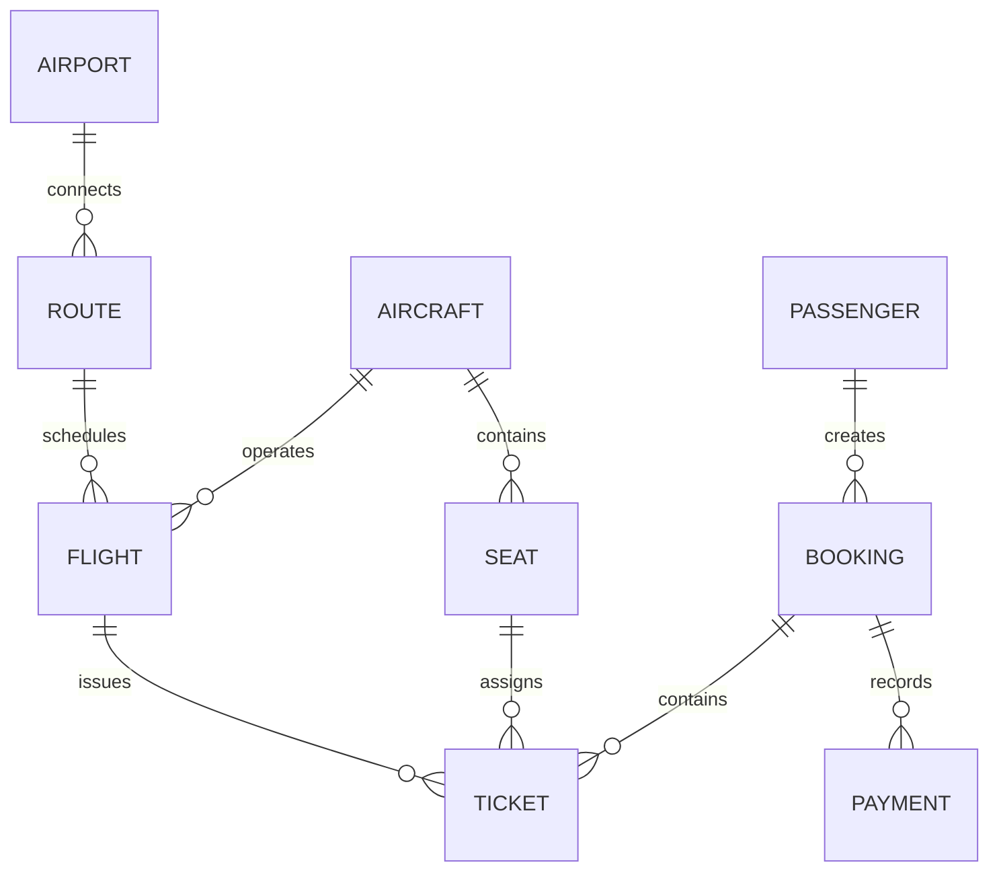

<div align="center">

# ✈️ Airline Booking System

**Discover flights. Choose your seat. Manage your journey.**

A full-stack airline reservation prototype powered by **Flask** and **PostgreSQL**, built as a database systems project at Kazakhstan-British Technical University (KBTU).


[Features](#-features) · [Quick start](#-getting-started) · [Database](#-database-design) · [Русский](#-на-русском)

</div>

---

## 🌍 Overview

Airline Booking System models the journey from **flight discovery to confirmed reservation**. It combines a passenger-facing travel interface with a staff dashboard, while a relational PostgreSQL database handles airports, routes, flights, aircraft, seats, passengers, bookings, tickets, and payments.

The project also includes an interactive **3D flight globe** with airport markers, route arcs, and animated aircraft. The globe is implemented with browser WebGL/Canvas; flight and route records are served from PostgreSQL.

> [!NOTE]
> This is a **university / portfolio project**. Flights, prices, and payments are demonstration data and logic. It is not connected to live airline inventory or a real payment gateway.

## ✨ Features

| Passenger experience | Staff experience |
| --- | --- |
| 🔎 Search flights by route and date | 📊 Dashboard with booking and flight statistics |
| 🗓️ Browse a flight-price calendar | 🛫 Create, edit, and cancel flights |
| 💺 View available seats on a seat map | 👥 View and manage passenger records |
| 🎫 Create bookings and receive a reference number | 📋 Create and manage reservations |
| 🔁 Find a reservation by reference and last name; request cancellation | 💳 Inspect ticket and payment-related information |
| 🌐 Explore destinations, weather, and a 3D route globe | 🔐 Session-protected admin pages with CSRF checks |

**UI details:** responsive page layouts, light/dark theme switcher, destination discovery pages, and interactive flight visualizations.

### Main pages

| URL | Purpose |
| --- | --- |
| `/` | Homepage and flight search |
| `/destinations` | Destination explorer |
| `/journey` | Travel inspiration |
| `/globe` | Interactive flight globe |
| `/manage-booking` | Retrieve or cancel a reservation |
| `/admin/login` | Staff login |
| `/admin` | Staff dashboard (after login) |

## 🧰 Tech stack

| Layer | Implementation |
| --- | --- |
| Backend | Python, Flask |
| Data access | Psycopg 3 |
| Database | PostgreSQL, relational constraints, indexes, SQL transactions |
| Frontend | Jinja2 templates, HTML, CSS, vanilla JavaScript |
| Visualization | Custom WebGL / Canvas flight globe |
| Optional external content | Open-Meteo weather, Wikipedia images, fallback destination photos |

## 🚀 Getting started

### 1. Requirements

- Python **3.11+**
- PostgreSQL installed and running; **PostgreSQL 18 tools are recommended** because the included backup was exported with PostgreSQL 18.3
- A PostgreSQL user with permission to create and restore a development database

### 2. Clone and install

```bash
git clone https://github.com/IrgaleyevRamil/Airline_project.git
cd Airline_project
```

Create a fresh virtual environment. **Do not use the committed `Airline_app_finalyzed/Scripts/` directory** as your environment.

**Windows PowerShell**

```powershell
py -m venv .venv
.\.venv\Scripts\Activate.ps1
python -m pip install flask "psycopg[binary]"
```

**macOS / Linux**

```bash
python3 -m venv .venv
source .venv/bin/activate
python -m pip install flask "psycopg[binary]"
```

> There is currently no `requirements.txt` in the repository. The above commands install the Python packages imported by the application.

### 3. Restore the database

The backup is stored at:

`Airline_booking_system_database/airline_booking_system_backup_1.sql`

**Despite its `.sql` extension, it is a PostgreSQL custom-format archive (`PGDMP`), not a plain SQL script.** Use **`pg_restore`**, not `psql -f`.

From the repository root, run:

```bash
createdb -U postgres airline_booking_system
pg_restore -U postgres --dbname=airline_booking_system --no-owner --no-privileges "Airline_booking_system_database/airline_booking_system_backup_1.sql"
```

Alternatively, create an empty `airline_booking_system` database in **pgAdmin**, then use **Restore** with *Custom* format and select the archive.

Use a **new, empty development database**. The commands assume the PostgreSQL user is `postgres`; change it if yours is different. If your `pg_restore` reports an unsupported archive version, use PostgreSQL 18 client tools.

Apply the included seat-availability update after restoring the original backup:

```bash
psql -U postgres -d airline_booking_system -f "Airline_app_finalyzed/upgrade_features.sql"
```

This replaces the old flight/seat uniqueness rule with an index that allows a seat from a **cancelled** ticket to be booked again.

### 4. Configure the connection

Open [`Airline_app_finalyzed/db.py`](Airline_app_finalyzed/db.py) and update `DB_CONFIG` for your local PostgreSQL instance:

```python
DB_CONFIG = {
    "host": "127.0.0.1",
    "port": 5432,
    "dbname": "airline_booking_system",
    "user": "postgres",
    "password": "your_local_postgres_password"
}
```

**Current code reads these values directly from `db.py`**, rather than a `.env` file. The demo admin password is currently set in `app.py`; change it before any shared deployment. For a stable Flask session key, set the optional `FLASK_SECRET_KEY` environment variable.

### 5. Run the app

```bash
cd Airline_app_finalyzed
python app.py
```

Open **http://127.0.0.1:5000**. The admin login is at **http://127.0.0.1:5000/admin/login**.

## 🗄️ Database design

The provided backup contains **nine main tables**:

| Entity | Responsibility |
| --- | --- |
| `airport` | Airport codes, cities, and time zones |
| `route` | Origin/destination airport pairs and distances |
| `aircraft` | Aircraft models and registration |
| `seat` | Aircraft seats and travel classes |
| `flight` | Scheduled services, aircraft assignments, and statuses |
| `passenger` | Passenger identity and contact information |
| `booking` | Reservation references and status |
| `ticket` | Flight and seat allocation, ticket price and status |
| `payment` | Demonstration payment records |

The model uses **primary keys, foreign keys, unique constraints, check constraints, and indexes**. Booking operations use database transactions, while seat availability is checked against active tickets.



Each route references **two** airports (origin and destination); the diagram simplifies those two foreign keys into a single connection.

## 📁 Project structure

```text
Airline_project/
├── Airline_app_finalyzed/
│   ├── app.py                   # Flask routes, booking logic and admin UI
│   ├── db.py                    # PostgreSQL connection configuration
│   ├── destination_info.py      # Destination metadata
│   ├── fix_destination_photos.py
│   ├── upgrade_features.sql     # Seat-rebooking database update
│   ├── templates/              # Jinja2 pages
│   ├── Static/style.css        # Main stylesheet (capital S)
│   └── Scripts/                # Committed local Python environment files
├── Airline_booking_system_database/
│   └── airline_booking_system_backup_1.sql  # Custom-format PG archive
└── README.md
```

## ⚠️ Current limitations

- **Local demo only.** The code has a hard-coded admin password and database credentials; these must be moved to environment-based configuration before deployment.
- **No real payments or airline API integration.** Payments and flight inventory are simulated.
- **External destination content** (weather/photos) needs an internet connection.
- **Case-sensitive systems:** the stylesheet directory is named `Static/` while Flask expects `static/` by default. If styles are missing on Linux, rename that directory locally or configure Flask's `static_folder` accordingly.
- **Testing and deployment:** automated tests, dependency pinning, and production deployment configuration are not included yet.

## 🧭 Roadmap

- [ ] Environment-based configuration and stronger admin authentication
- [ ] Automated tests for reservations, cancellation, and concurrent seat selection
- [ ] `requirements.txt`, `.gitignore`, and reproducible setup
- [ ] Database migrations and Docker Compose support
- [ ] Production deployment and CI pipeline

## 🇷🇺 На русском

**Airline Booking System** — учебный full-stack проект КБТУ: сайт для поиска авиарейсов, выбора места, бронирования билетов и управления заказами, а также панель администратора с аналитикой. Бэкенд написан на **Python + Flask**, данные хранятся в **PostgreSQL**, интерфейс реализован на **HTML/CSS/JavaScript**, включая интерактивный 3D-глобус авиамаршрутов.

**Что умеет:** поиск рейсов и цен, схема мест, оформление и отмена брони, просмотр направлений, управление рейсами и пассажирами в админ-панели.

**Как запустить:** клонировать репозиторий → создать `.venv` → установить `flask` и `psycopg[binary]` → восстановить базу через **`pg_restore`** (файл с расширением `.sql` на самом деле в custom-формате) → выполнить `upgrade_features.sql` → указать параметры PostgreSQL в `db.py` → запустить `Airline_app_finalyzed/app.py`. Подробные команды находятся в разделе [Getting started](#-getting-started).

> Проект предназначен для обучения и портфолио. Подключения к реальным авиакомпаниям и приёма настоящих платежей нет.

---

<div align="center">

Built by [**IrgaleyevRamil**](https://github.com/IrgaleyevRamil) · Kazakhstan-British Technical University

</div>
