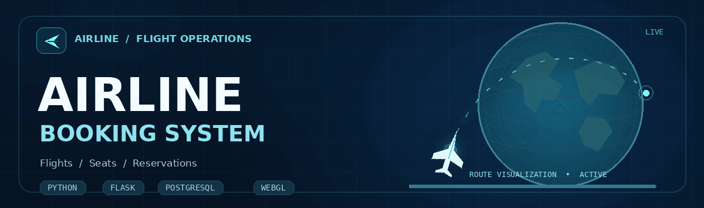
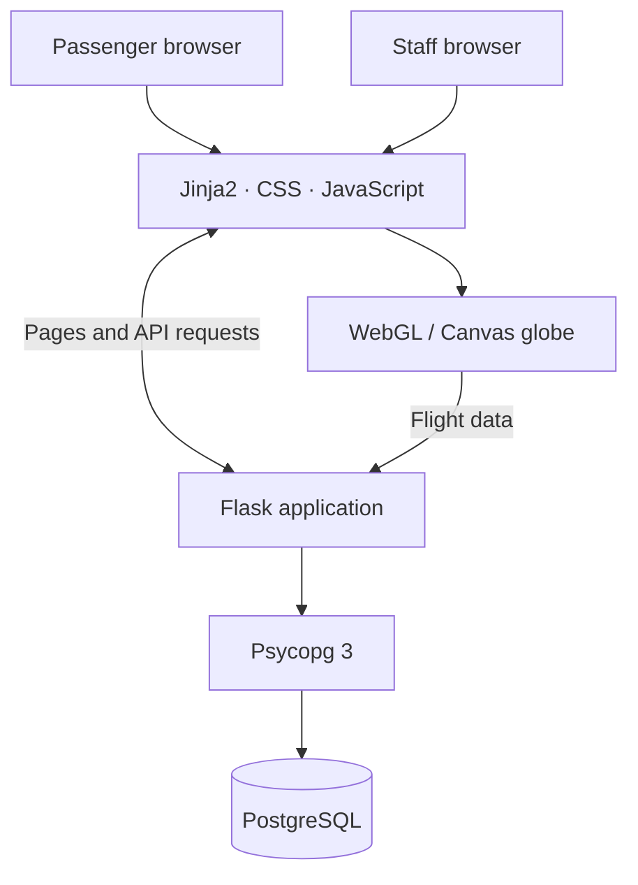
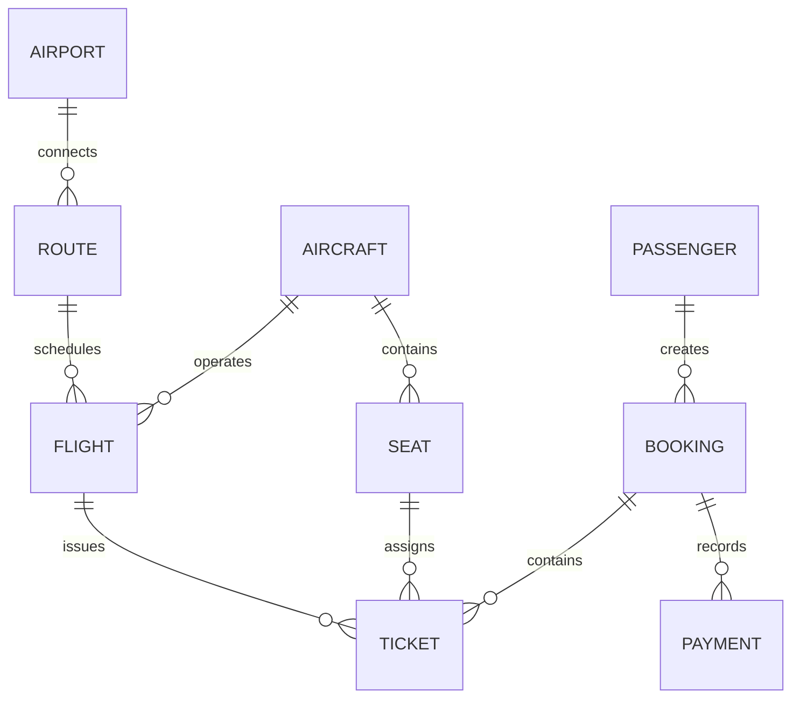

<div align="center">



<a href="#overview">
  <picture>
    <source media="(prefers-color-scheme: dark)" srcset="https://readme-typing-svg.demolab.com?font=JetBrains+Mono&weight=600&size=20&duration=3300&pause=900&color=62D9EB&center=true&vCenter=true&width=760&height=48&lines=Search+flights.+Choose+seats.+Take+off.;Explore+routes+on+an+interactive+3D+globe.;Flask+%2B+PostgreSQL+%2B+JavaScript." />
    
  </picture>
</a>

<h3>From flight discovery to confirmed booking.</h3>

An airline reservation and operations platform built with **Python, Flask, PostgreSQL, and JavaScript**.<br />
A database systems project developed at **Kazakhstan-British Technical University (KBTU)**.

<p>
  <a href="#features"></a>
  <a href="#quick-start"></a>
  <a href="#architecture"></a>
  <a href="#russian"></a>
</p>

<p>
  
  
  
  
  
</p>

[Overview](#overview) · [Features](#features) · [App tour](#app-tour) · [Architecture](#architecture) · [Quick start](#quick-start) · [Database](#database) · [Roadmap](#roadmap)

</div>

---

## Overview

**Airline Booking System** brings the main parts of an airline workflow into one web application: passengers can find flights, check seat availability, create reservations, and manage bookings, while staff can operate flights and review booking data from an admin dashboard.

One of its most visual features is an **interactive flight globe** with airport markers, route arcs, aircraft, and a WebGL / Canvas rendering path. Route information comes from the application's PostgreSQL-backed API.

> [!IMPORTANT]
> This is an **academic / portfolio prototype**, not a live booking service. Flight inventory, prices, and payment records are demonstration data; no real tickets are issued and no real payment gateway is connected.

## Features

<table>
  <tr>
    <th width="50%">✈️ Passenger experience</th>
    <th width="50%">🧭 Airline operations</th>
  </tr>
  <tr>
    <td>🔎 Search by origin, destination, and date</td>
    <td>📊 View flight and booking statistics</td>
  </tr>
  <tr>
    <td>🗓️ Explore prices on a flight calendar</td>
    <td>🛫 Create, update, and cancel flights</td>
  </tr>
  <tr>
    <td>💺 Inspect seat availability and select a seat</td>
    <td>👥 Inspect passenger information</td>
  </tr>
  <tr>
    <td>🎫 Book flights and receive a booking reference</td>
    <td>📋 Create and manage reservations</td>
  </tr>
  <tr>
    <td>🔁 Retrieve or request cancellation of a booking</td>
    <td>🔐 Access session-protected admin screens</td>
  </tr>
  <tr>
    <td>🌍 Discover destinations and explore a 3D globe</td>
    <td>💳 Review demo ticket and payment records</td>
  </tr>
</table>

**Open a feature to see what is inside:**

<details>
<summary><b>🔎 Flight discovery · search, dates, and prices</b></summary>

The passenger-facing home page supports route selection and date-based search. A two-month interactive calendar can show available flight prices for a selected route.

**Source:** [`home.html`](Airline_app_finalyzed/templates/home.html) · [`search_results.html`](Airline_app_finalyzed/templates/search_results.html)

</details>

<details>
<summary><b>💺 Reservations · seat map, booking, and cancellation</b></summary>

Passengers can view seat availability, make a booking, receive a reservation reference, and later look up a reservation by reference and surname. The database update in `upgrade_features.sql` permits a seat from a cancelled ticket to be sold again.

**Source:** [`customer_booking.html`](Airline_app_finalyzed/templates/customer_booking.html) · [`manage_booking.html`](Airline_app_finalyzed/templates/manage_booking.html) · [`upgrade_features.sql`](Airline_app_finalyzed/upgrade_features.sql)

</details>

<details>
<summary><b>🌐 Globe · routes, airports, and animated aircraft</b></summary>

The browser renders an interactive Earth visualization with route lines, airport markers, and aircraft. It has a Canvas fallback for environments where WebGL is unavailable. Flight data is requested from `/api/globe-data`.

**Source:** [`globe.html`](Airline_app_finalyzed/templates/globe.html) · [`app.py`](Airline_app_finalyzed/app.py)

</details>

<details>
<summary><b>📊 Control center · administration and analytics</b></summary>

Staff-facing views cover flights, passengers, bookings, and ticket/payment information. Admin pages use a session-based login and CSRF checks, but the demo credentials must be replaced before deployment.

**Source:** [`dashboard.html`](Airline_app_finalyzed/templates/dashboard.html) · [`flights.html`](Airline_app_finalyzed/templates/flights.html) · [`bookings.html`](Airline_app_finalyzed/templates/bookings.html)

</details>

## App tour

Follow the passenger journey through the source code. These links open the actual templates, **not a hosted live demo**.

| Step | Screen | What happens | Explore |
| :---: | --- | --- | --- |
| `01` | **Find a flight** | Pick an origin, destination, and travel date | [Home & search](Airline_app_finalyzed/templates/home.html) |
| `02` | **Choose a flight** | Compare the matching scheduled flights | [Results](Airline_app_finalyzed/templates/search_results.html) |
| `03` | **Reserve a seat** | Check availability and enter passenger details | [Booking](Airline_app_finalyzed/templates/customer_booking.html) |
| `04` | **Get confirmation** | Receive a unique reference for the reservation | [Confirmation](Airline_app_finalyzed/templates/confirmation.html) |
| `05` | **Manage the trip** | Look up or cancel the reservation | [Manage booking](Airline_app_finalyzed/templates/manage_booking.html) |

<p align="center">
  <a href="Airline_app_finalyzed/templates/globe.html"></a>
  <a href="Airline_app_finalyzed/templates/dashboard.html"></a>
</p>

## Architecture

The interface uses Jinja2 templates and vanilla JavaScript. Flask serves pages and JSON endpoints, Psycopg 3 handles database access, and PostgreSQL stores the relational data.



| Layer | Implementation |
| --- | --- |
| Backend | Python, Flask |
| Frontend | Jinja2, HTML, CSS, vanilla JavaScript |
| Database access | Psycopg 3 |
| Data storage | PostgreSQL, constraints, indexes, transactions |
| Visualization | Custom WebGL / Canvas flight globe |
| Optional online content | Open-Meteo weather, Wikipedia images, fallback destination photos |

## Quick start

> [!NOTE]
> **Local setup only.** You need Python **3.11+** and a running PostgreSQL server. PostgreSQL **18 client tools** are recommended for restoring the included archive, which was exported with PostgreSQL 18.3.

### 1. Clone the project

```bash
git clone https://github.com/IrgaleyevRamil/Airline_project.git
cd Airline_project
```

### 2. Install Python dependencies

<details open>
<summary><b>🪟 Windows · PowerShell</b></summary>

```powershell
py -m venv .venv
.\.venv\Scripts\Activate.ps1
python -m pip install flask "psycopg[binary]"
```

</details>

<details>
<summary><b>🐧 Linux / macOS</b></summary>

```bash
python3 -m venv .venv
source .venv/bin/activate
python -m pip install flask "psycopg[binary]"
```

</details>

There is no `requirements.txt` yet. Do **not** reuse the committed `Airline_app_finalyzed/Scripts/` virtual-environment files; create your own `.venv` as above.

### 3. Restore PostgreSQL data

The database archive is located at `Airline_booking_system_database/airline_booking_system_backup_1.sql`.

**Important:** Despite the `.sql` extension, this is a **PostgreSQL custom-format archive (`PGDMP`)**, so use `pg_restore`, **not** `psql -f`.

Run from the repository root against a **new, empty development database**:

```bash
createdb -U postgres airline_booking_system
pg_restore -U postgres --dbname=airline_booking_system --no-owner --no-privileges "Airline_booking_system_database/airline_booking_system_backup_1.sql"
```

Apply the included seat-availability update:

```bash
psql -U postgres -d airline_booking_system -f "Airline_app_finalyzed/upgrade_features.sql"
```

You can also restore the archive with **pgAdmin → Restore → Custom**. Replace `postgres` in the commands if your database user is different. An *unsupported archive version* error usually means you need newer PostgreSQL client tools.

### 4. Configure your database connection

Edit [`Airline_app_finalyzed/db.py`](Airline_app_finalyzed/db.py) for your local database:

```python
DB_CONFIG = {
    "host": "127.0.0.1",
    "port": 5432,
    "dbname": "airline_booking_system",
    "user": "postgres",
    "password": "your_local_postgres_password"
}
```

The current code reads this dictionary directly rather than using a `.env` file. Set `FLASK_SECRET_KEY` in the environment if you want a stable session key between restarts.

### 5. Launch the server

```bash
cd Airline_app_finalyzed
python app.py
```

Open **http://127.0.0.1:5000** in your browser. The staff login page is at **http://127.0.0.1:5000/admin/login**.

<details>
<summary><b>🛠️ Troubleshooting · click to expand</b></summary>

- **Styles missing on Linux?** The repository directory is named `Static/` with an uppercase `S`, while Flask defaults to `static/`. Rename it locally or configure `static_folder`.
- **`pg_restore` refuses the backup?** Check your PostgreSQL client version; use PostgreSQL 18 tools if the archive version is not recognized.
- **Database connection fails?** Confirm PostgreSQL is running, the database exists, and `db.py` matches your host, port, user, and password.
- **External destination images or weather missing?** These optional features use online services and may require an internet connection.

</details>

## Database

The included backup contains **nine core tables**:

| Table | Purpose |
| --- | --- |
| `airport` | Airport identity, city, time zone |
| `route` | Origin/destination pairs and distances |
| `aircraft` | Aircraft models and registrations |
| `seat` | Aircraft seat numbers and travel classes |
| `flight` | Schedules, aircraft, operational status |
| `passenger` | Traveller identity and contact data |
| `booking` | Reservations, reference numbers, status |
| `ticket` | Seat assignments, prices, ticket status |
| `payment` | Demonstration payment entries |

<details>
<summary><b>🗄️ Show the entity-relationship diagram</b></summary>



Each route references **two airports**, one for departure and one for arrival; the diagram combines these two relationships for readability. Primary/foreign keys, uniqueness rules, checks, indexes, and transactions protect data consistency.

</details>

## Repository map

```text
Airline_project/
├── README.md
├── assets/
│   └── airline-header.gif              # Animated README banner
├── Airline_app_finalyzed/
│   ├── app.py                          # Flask application and API
│   ├── db.py                           # PostgreSQL connection settings
│   ├── destination_info.py             # Destination metadata
│   ├── upgrade_features.sql            # Booking/seat availability fix
│   ├── templates/                      # Passenger and staff pages
│   └── Static/style.css                # Frontend stylesheet
└── Airline_booking_system_database/
    └── airline_booking_system_backup_1.sql
```

## Roadmap

- [ ] Move database credentials and the admin secret to environment variables
- [ ] Add automated tests for booking, cancellation, and concurrent seat selection
- [ ] Introduce `requirements.txt`, `.gitignore`, and a reproducible setup
- [ ] Add versioned database migrations and Docker Compose
- [ ] Build a CI pipeline and a safe public demo deployment

<details>
<summary><b>⚠️ Known limitations and security notes</b></summary>

- The demonstration admin password and database credentials are currently hard-coded in source files. **Do not deploy publicly with these values.**
- The project does not connect to live airline inventory or accept real payments.
- Automated tests, pinned dependencies, and production deployment settings are not included yet.
- Online weather and destination content depend on third-party services.
- The `Static/` vs. `static/` directory-name mismatch can affect asset loading on case-sensitive systems.

</details>

## Russian

<details open>
<summary><b>🇷🇺 О проекте на русском</b></summary>

**Airline Booking System** — мой учебный full-stack проект в КБТУ: система поиска авиарейсов, выбора мест, бронирования билетов и управления заказами с административной панелью.

- **Backend:** Python + Flask.
- **База данных:** PostgreSQL, 9 основных таблиц, ограничения целостности и транзакции.
- **Frontend:** HTML, CSS, JavaScript и Jinja2.
- **Особенности:** календарь цен, интерактивная схема мест, 3D-глобус с маршрутами и самолётами, админ-панель.

**Как запустить:** клонировать репозиторий → создать `.venv` → установить Flask и Psycopg → восстановить базу через `pg_restore` → выполнить `upgrade_features.sql` → настроить `db.py` → запустить `app.py`. Команды приведены в [Quick start](#quick-start).

Проект демонстрационный: реальные билеты не продаются и платежи не принимаются.

</details>

---

<div align="center">

<h3>✈️ Thanks for stopping by!</h3>

Built by <a href="https://github.com/IrgaleyevRamil"><b>IrgaleyevRamil</b></a> · Kazakhstan-British Technical University

<p>
  <a href="https://github.com/IrgaleyevRamil/Airline_project"></a>
  <a href="https://github.com/IrgaleyevRamil"></a>
</p>

</div>
